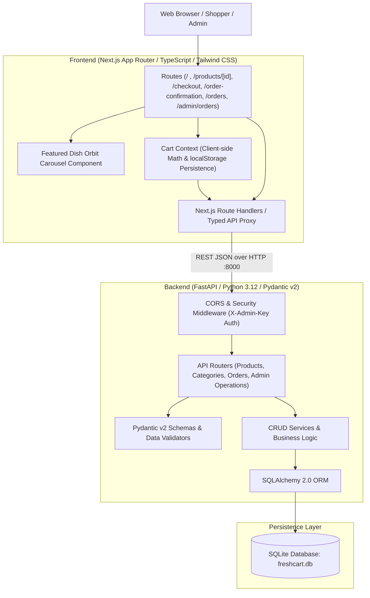

# Architecture Overview

**Project:** FreshCart — Online Grocery Application  
**Architecture Style:** Decoupled Client-Server (REST API + Single Page Application)  
**Target Scope:** 6 Original User Stories across 3 Sprints (29 Committed Story Points)

---

## 1. System Architecture Diagram

---

## 2. Component Descriptions

### 1. Frontend (`frontend/`)
* **Framework:** Next.js (App Router) + TypeScript.
* **Styling:** Tailwind CSS with grocery-themed color palette.
* **Key Components & Routes:**
  * **Homepage (`/`):** Promotional banners, category pills, search bar, and interactive **Dish Orbit Carousel** (4.0s autoplay loop, pause on hover, manual navigation, and quick Add to Cart).
  * **Product Detail Page (`/products/[id]`):** High-resolution product images, pricing, unit descriptions, and live stock availability badges.
  * **Cart Drawer:** Real-time itemized calculation, quantity limits, free delivery threshold, and client-side persistence (`localStorage`).
  * **Checkout (`/checkout`):** Form validation (name, 10-digit phone, address, 6-digit postal code) and payment method selection.
  * **Payment Mechanics:** **Payment is simulated, with Cash on Delivery (COD) available. No external banking gateway or merchant gateway is utilized.**
  * **Order Confirmation (`/order-confirmation`) & History (`/orders`):** Order receipts and milestone tracking.
  * **Delivery Tracking:** **Delivery tracking is status-based (milestone progression: Placed → Confirmed → Preparing → Out for Delivery → Delivered). It is not live GPS tracking.**
  * **Admin Console (`/admin/orders`):** Authenticated administrative dashboard for live store KPIs, status updates, stock adjustments, and inventory movement auditing.

### 2. Backend (`backend/`)
* **Framework:** FastAPI with Python 3.12 and auto-generated OpenAPI documentation (`/docs`).
* **Validation & Serialization:** Pydantic v2 models guaranteeing strict request/response contracts and schema enforcement.
* **Security & Access Control:** Role-Based Access Control enforcing `X-Admin-Key` header authentication on `/api/admin/*` routes while maintaining unrestricted customer endpoints.
* **Data Access:** SQLAlchemy 2.0 with declarative models, atomic transactions, and scoped database sessions.

### 3. Persistence Layer (`freshcart.db`)
* **Engine:** SQLite 3 file-based storage.
* **Entities:**
  * `Category`: Grocery category taxonomy (`fruits`, `vegetables`, `dairy-eggs`, `bakery`, `beverages`, `snacks`, `staples`).
  * `Product`: Catalog items with pricing, unit definitions, image references, and real-time stock levels.
  * `Order`: Customer orders with references (`FC-YYYYMMDD-XXXXXXXX`), shipping info, payment method (`cod` / `simulated`), and lifecycle status.
  * `OrderItem`: Line items linking products, purchase unit prices, and quantities to orders.
  * `InventoryMovement`: Comprehensive audit ledger recording stock events (`stock_in`, `stock_out`, `adjustment`) with before/after counts, timestamps, reason strings, and user attribution.
